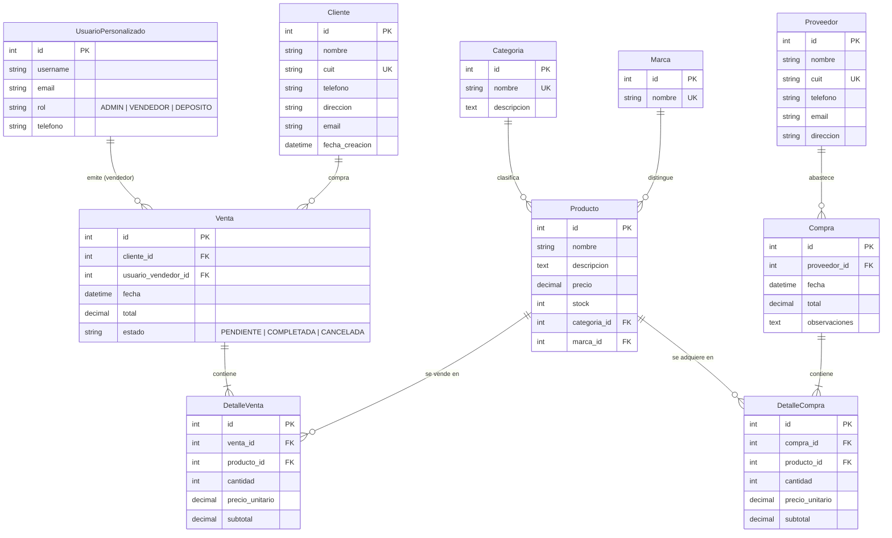

# Ferretería y Corralón - Tuerca y Perno RC 🔩🧱

**Evaluación Final Integradora (EFI) - Ingeniería de Software**  
Backend desarrollado en **Python 3.12+**, **Django 5** y **Django REST Framework (DRF)**, gestionado con **`uv`** y completamente **dockerizado**.

---

## 📋 Descripción del Proyecto e Identidad

**"Tuerca y Perno RC"** es un sistema integral de gestión comercial, inventario, ventas y reabastecimiento diseñado para una empresa del rubro ferretero y corralón de materiales para la construcción.

El backend expone una **API REST robusta, paginada, filtrable y documentada** bajo estándares OpenAPI 3.0, pensada para ser consumida de forma desacoplada por una aplicación Frontend desarrollada en Programación III.

---

## 🏛️ Planificación de Base de Datos y Modelo Entidad-Relación (DER)

El sistema cuenta con **10 modelos relacionales normalizados**, distribuidos limpiamente entre la app de autenticación (`usuarios`) y la app comercial (`negocio`):

### Diagrama Entidad-Relación (Mermaid)



### Detalle de Modelos
1. **`UsuarioPersonalizado`** (`usuarios.models`): Hereda de `AbstractUser`. Maneja credenciales seguras, teléfono y roles operativos (`ADMIN`, `VENDEDOR`, `DEPOSITO`).
2. **`Cliente`** (`negocio.models`): Registro de compradores con nombre, CUIT único, datos de contacto y domicilio.
3. **`Categoria`** (`negocio.models`): Clasificación por rubros (Tornillería, Sanitarios, Corralón, Pinturas, Herramientas).
4. **`Marca`** (`negocio.models`): Fabricantes y marcas asociadas (Stanley, Bosch, Loma Negra, Acindar, Sinteplast).
5. **`Producto`** (`negocio.models`): Catálogo de artículos con control de precio, existencias (`stock`), y claves foráneas hacia `Categoria` y `Marca`.
6. **`Proveedor`** (`negocio.models`): Empresas y mayoristas proveedoras de mercadería y materiales áridos.
7. **`Compra`** (`negocio.models`): Registro de operaciones de reabastecimiento vinculadas a un proveedor.
8. **`DetalleCompra`** (`negocio.models`): Líneas de ítems comprados. Incrementa el stock de inventario.
9. **`Venta`** (`negocio.models`): Cabecera de transacción con cliente, vendedor autenticado (`AUTH_USER_MODEL`), total y estado.
10. **`DetalleVenta`** (`negocio.models`): Líneas de productos despachados con cálculo automático de subtotal y descuento de stock.

---

## 🛠️ Stack Tecnológico

- **Lenguaje:** Python 3.12+
- **Gestor de Entorno y Paquetes:** [uv](https://docs.astral.sh/uv/) (Astral)
- **Framework Web:** Django 5.x
- **Framework API REST:** Django REST Framework (DRF) 3.15+
- **Autenticación:**
  - Token JWT: `djangorestframework-simplejwt`
  - Sesión: `SessionAuthentication` para API navegable
- **Documentación API:** `drf-spectacular` (OpenAPI 3.0, Swagger UI, ReDoc)
- **Filtros y Búsqueda:** `django-filter` y `SearchFilter`
- **CORS:** `django-cors-headers` (con soporte para frontend)
- **Base de Datos:** SQLite (desarrollo local)
- **Contenedorización:** Docker & Docker Compose

---

## 🚀 Requisitos Cumplidos de la EFI

- [x] **10 Modelos relacionales normalizados** y relevantes para la ferretería y corralón.
- [x] **10 ViewSets registrados** mediante `DefaultRouter` (supera el mínimo de 8).
- [x] **Nested Serializers en list (get all)**: En `ProductoViewSet`, `VentaViewSet` y `CompraViewSet` se muestran datos anidados completos al consultar `list`, y representación plana con IDs en `retrieve` y escritura.
- [x] **Autenticación Dual**: SimpleJWT (`Bearer <token>`) y Session Authentication (`/api-auth/`).
- [x] **Acciones personalizadas (`@action`)**:
  - `POST /api/productos/{id}/actualizar-stock/`: Ajuste manual de stock (sumar, restar, fijar).
  - `GET /api/ventas/ventas-del-dia/`: Consulta de ventas registradas en la fecha actual.
  - `POST /api/ventas/{id}/finalizar-venta/`: Cierre y confirmación de venta.
- [x] **Paginación global**: `PageNumberPagination` a 10 ítems por página.
- [x] **Filtros y búsqueda**: Búsqueda por texto en nombre/descripción y filtros por categoría/marca en `ProductoViewSet`.
- [x] **Documentación interactiva**: Swagger UI, ReDoc y OpenAPI schema disponibles.
- [x] **Vista principal tradicional**: Template HTML de bienvenida en `/`.
- [x] **Panel de Administración**: 10 modelos configurados con filtros, inlines y búsquedas.
- [x] **CORS configurado** para conexión inmediata con el Frontend.
- [x] **Dockerizado** con `Dockerfile` y `docker-compose.yml`.

---

## 💻 Instalación y Puesta en Marcha

### Opción 1: Con `uv` (Recomendado para desarrollo local)

```bash
# 1. Clonar el repositorio
git clone git@github.com:leandroitec/tuerca_y_perno_RC.git
cd tuerca_y_perno_RC

# 2. Crear entorno virtual con uv e instalar dependencias
uv venv
source .venv/bin/activate
uv pip install -e .

# 3. Aplicar migraciones
python manage.py makemigrations usuarios
python manage.py makemigrations negocio
python manage.py migrate

# 4. Cargar datos iniciales de prueba (usuarios, categorías, productos, clientes)
python manage.py poblar_datos

# 5. Ejecutar la suite de pruebas unitarias
python manage.py test

# 6. Iniciar el servidor de desarrollo
python manage.py runserver
```

### Opción 2: Con Docker y Docker Compose

```bash
# Construir y levantar el contenedor en segundo plano
docker compose up --build -d

# Ejecutar carga de datos iniciales dentro del contenedor
docker compose exec web python manage.py poblar_datos
```

El servidor quedará disponible en: `http://127.0.0.1:8000/`

---

## 🔑 Credenciales de Prueba Precargadas

| Usuario | Contraseña | Rol | Acceso |
| :--- | :--- | :--- | :--- |
| **admin** | `admin123` | Administrador | Django Admin & API completa |
| **vendedor** | `vendedor123` | Vendedor | API comercial y ventas |

---

## 🌐 Endpoints Principales

| Recurso / Herramienta | Método / URL | Descripción |
| :--- | :--- | :--- |
| **Página de Bienvenida** | `GET /` | Dashboard de bienvenida con métricas y enlaces |
| **Swagger UI** | `GET /api/docs/` | Documentación interactiva OpenAPI 3 |
| **ReDoc** | `GET /api/redoc/` | Especificación técnica OpenAPI |
| **Esquema OpenAPI** | `GET /api/schema/` | Esquema OpenAPI en formato JSON/YAML |
| **Panel de Administración** | `GET /admin/` | Panel administrativo Django |
| **Obtener Token JWT** | `POST /api/auth/token/` | Autenticación con `username` y `password` |
| **Refrescar Token JWT** | `POST /api/auth/token/refresh/` | Renovación de token de acceso |
| **Login DRF Browsable API** | `GET /api-auth/login/` | Autenticación por sesión para navegador |
| **Catálogo de Productos** | `GET /api/productos/` | Listado paginado con categoría y marca anidadas |
| **Actualizar Stock (@action)** | `POST /api/productos/{id}/actualizar-stock/` | Sumar, restar o fijar existencias |
| **Ventas del Día (@action)** | `GET /api/ventas/ventas-del-dia/` | Listado de transacciones del día |
| **Finalizar Venta (@action)** | `POST /api/ventas/{id}/finalizar-venta/` | Marcar venta como completada |

---

## 📸 Capturas del Proyecto en Funcionamiento

> *Aquí puedes adjuntar las capturas de pantalla tomadas del proyecto en ejecución para la entrega final.*

### 1. Template de Bienvenida (`/`)

*(Vista principal con estadísticas y accesos directos al sistema)*

### 2. Documentación Interactiva Swagger UI (`/api/docs/`)

*(Exploración y prueba de endpoints protegidos mediante token Bearer JWT)*

### 3. Panel de Administración de Django (`/admin/`)

*(Gestión de productos, categorías, ventas y compras con inlines)*

### 4. Consultas a la API REST (Postman / Swagger)

*(Respuesta de endpoints con paginación y datos anidados mediante NestedSerializers)*
